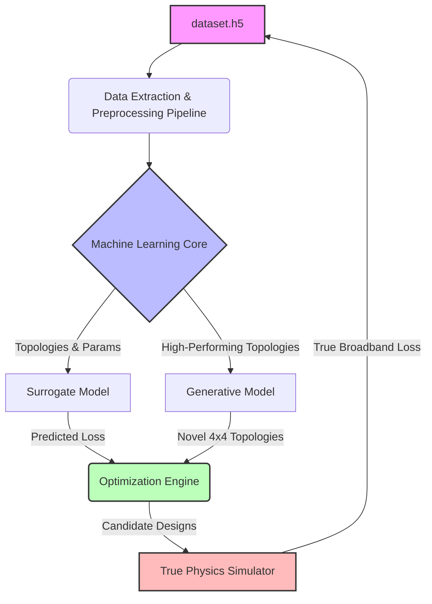

# UIFO Design Challenge Analysis & Impactful Solutions

## 1. Current Implementation Context
The current implementation revolves around the `dataset_dashboard.html` visualization tool, which provides an interface to analyze a pre-computed corpus of UIFO (Unknown, Identified, Flying, Object - or similar domain-specific acronym, likely related to optical/photonic or antenna detector designs) detector designs. 

### Key Dataset Statistics (The Results):
- **Total Designs (Rows):** 29,650
- **3x3 UIFOs:** 26,692 (Optimized from random parameters to convergence)
- **Reoptimized 3x3 UIFOs:** 2,171 (Starting from local optima + noise, re-optimized)
- **4x4 UIFOs:** 787 (Optimized from random parameters to convergence)
- **Topology Strings:** 12,437 (11,797 one-off, 640 repeated)
- **Total Continuous Parameters Stored:** 5,780,308
- **Heuristically Feasible Designs:** 6,798 (22.93%)
- **Random Baseline Loss:** ~6.466

### Analysis Reports Available
Detailed analysis has been completed and is available in the following reports:
- [Dataset Summary](file:///c:/Users/surwe/Project/Learn2Design-2026/analysis/results/dataset_summary.md)
- [Feasibility & Power Analysis](file:///c:/Users/surwe/Project/Learn2Design-2026/analysis/results/reports/feasibility_report.md)
- [Parameter Distributions Report](file:///c:/Users/surwe/Project/Learn2Design-2026/analysis/results/parameter_distributions_report.md)
- Tabular data available in CSV: [Parameters](file:///c:/Users/surwe/Project/Learn2Design-2026/analysis/results/parameter_statistics.csv), [Topologies](file:///c:/Users/surwe/Project/Learn2Design-2026/analysis/results/topology_statistics.csv), and [Loss/Power](file:///c:/Users/surwe/Project/Learn2Design-2026/analysis/results/parameter_loss_statistics.csv).

**Objective of the Dataset:** 
To serve as offline development data for competition algorithms. It provides a mapping from a topology string and continuous parameters to a pure-broadband loss.

## 2. What Needs to be Changed & Updated (The Challenge)
The core challenge is finding UIFO designs with a loss significantly better (lower) than the random baseline (6.466) and the current set of optima, especially as the design space scales from 3x3 to 4x4 and beyond. 

**Areas for Update & Improvement:**
1.  **Scaling to 4x4 and Beyond:** The dataset only contains 787 4x4 designs compared to ~26k 3x3 designs. The search strategy needs to be updated to efficiently explore larger, exponentially more complex 4x4 or 5x5 topology spaces.
2.  **Overcoming Local Optima:** The presence of "Reoptimized" designs indicates that the loss landscape is highly non-convex. The optimization strategy must be updated to avoid getting trapped in poor local minima.
3.  **Reducing Evaluation Time:** Evaluating "pure-broadband loss" is likely computationally expensive.

## 3. Impactful Solutions (Strategic Approach)

To dominate this challenge, we should transition from blind/random search to data-driven, machine learning-accelerated optimization.

### A. Surrogate Model-Assisted Optimization
- **Implementation:** Train a fast Machine Learning surrogate model (e.g., a Graph Neural Network for the topologies or a Random Forest/XGBoost for the continuous parameters) on the 29,650 existing data points.
- **Impact:** Instead of evaluating thousands of designs using the slow, true loss function, the surrogate model can predict the loss in milliseconds. We can screen millions of potential designs and only evaluate the top 0.01% with the true function.

### B. Topology Generation via Generative AI
- **Implementation:** The 12,437 topology strings represent a "language" of designs. We can train a generative model (like a Variational Autoencoder, Diffusion Model, or a lightweight Transformer) on the highest-performing topologies.
- **Impact:** The model will learn the underlying "grammar" of good designs and can hallucinate entirely novel, high-performing 4x4 topologies that human intuition or random search would never find.

### C. Smart Initialization Strategy
- **Implementation:** Instead of starting new 4x4 optimizations from random parameters, use Transfer Learning. Map the best 3x3 topologies into the 4x4 space (e.g., by embedding them in a corner or scaling them up) and use those as starting points.
- **Impact:** Drastically reduces the number of iterations required to reach convergence and guarantees a starting loss already better than the random baseline.

### D. Advanced Local Search (Basin Hopping)
- **Implementation:** Implement a "Basin Hopping" or Evolutionary Algorithm (like CMA-ES) that takes the known good parameters, applies targeted mutations (adding specific noise profiles), and re-optimizes. 
- **Impact:** This directly attacks the "local optima" problem, allowing the algorithm to jump out of a good valley and find the global best valley.

## 4. Proposed System Architecture

To execute the impactful solutions, the system architecture should be structured as follows:

**Components:**
1.  **Data Extraction Pipeline:** Reads `dataset.h5`, parses topologies into graph structures (or flattened arrays), and normalizes continuous parameters.
2.  **Machine Learning Core:** Hosts the PyTorch/TensorFlow models.
    *   **Surrogate Model:** A Graph Neural Network (GNN) combined with a Multi-Layer Perceptron (MLP) to quickly map (topology + parameters) -> predicted loss.
    *   **Generative Model:** A VAE that learns the distribution of high-performing designs to sample new topologies.
3.  **Optimization Engine:** Uses Bayesian Optimization or CMA-ES, querying the Surrogate Model to propose the next best candidates.
4.  **True Physics Simulator:** The (expensive) ground truth function that calculates the actual pure-broadband loss. New results are fed back into the dataset to continuously improve the ML models.

## 5. Implementation Plan

Based on the architecture and impactful solutions, here is the phased implementation plan:

### Phase 1: Data Infrastructure & Baselines (Week 1) - **IN PROGRESS / PARTIALLY COMPLETE**
*   ~~**Task 1.1:** Develop a robust Python parser for `dataset.h5` using `h5py` and `pandas`.~~ *(Complete)*
*   ~~**Task 1.2:** Analyze the correlation between different topology features and the loss.~~ *(Complete - See Analysis Reports)*
*   **Task 1.3:** Train a baseline Random Forest regressor to predict the loss from flattened parameters. This sets the benchmark for the surrogate model.

### Phase 2: Surrogate Model Development (Week 2-3)
*   **Task 2.1:** Design a PyTorch Geometric (PyG) model to handle the topology strings as graph inputs.
*   **Task 2.2:** Train the GNN + MLP surrogate model using the 29,650 existing data points.
*   **Task 2.3:** Validate the surrogate model's accuracy (RMSE/MAE) against a held-out test set from the corpus.

### Phase 3: Generative Topology Design (Week 4-5)
*   **Task 3.1:** Filter the dataset to isolate the top 10% highest-performing topologies (lowest loss).
*   **Task 3.2:** Train a Variational Autoencoder (VAE) on these top topologies.
*   **Task 3.3:** Generate 10,000 novel 4x4 topologies using the trained VAE and evaluate them using the Surrogate Model to find the most promising candidates.

### Phase 4: Active Optimization Loop (Week 6)
*   **Task 4.1:** Integrate the Surrogate Model with an optimization framework (like Optuna or BoTorch).
*   **Task 4.2:** Implement the Basin Hopping logic to handle local optima.
*   **Task 4.3:** Run the full loop: Generate/Mutate -> Surrogate Evaluate -> Select Top K -> True Physics Evaluate -> Update Models.
