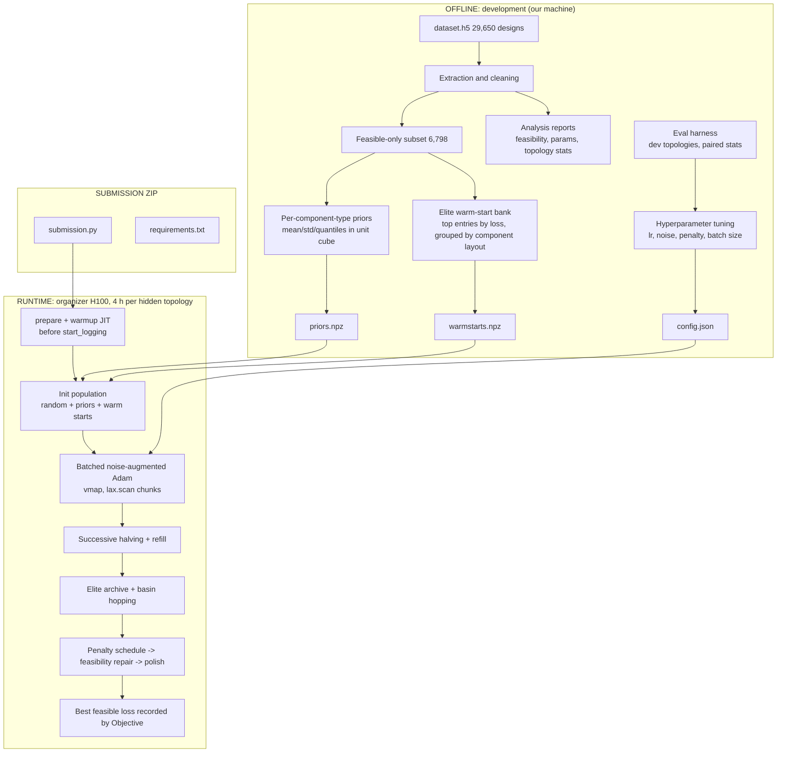

# Learn2Design-2026: Architecture & Project Completion Plan (v2)

Internal submission target: **Tue 13 Oct 2026** (official deadline 15 Oct AoE).
Status date: Sat 10 Oct 2026.

---

## 1. What changed from v1, and why

| v1 assumption | v2 correction |
|---|---|
| UIFO = "Unknown, Identified, Flying, Object" | UIFO = **Quasi-Universal Interferometer** (gravitational-wave detector search space) |
| Generate novel topologies with a VAE; scale to 4x4/5x5 search | **Topologies are given and hidden.** We only optimize ~200 continuous parameters per topology. No topology generator is needed for scoring |
| GNN surrogate screens millions of designs | Surrogate is optional and only worth keeping if it pays off within the first minutes of the 4 h run. The simulator is differentiable, and gradient methods already win (NAAdamGD 0.504 vs CMA-ES 3.55) |
| Output = designs | Output = a **`submission.py` algorithm** (plus bundled files) that the organizers run on hidden topologies |
| Phases run over weeks | Only ~3 days remain before our internal deadline |

New facts from the completed analysis (Phase 1) that now drive design:

- 29,650 designs: 26,692 3x3 (random start), 2,171 reoptimized 3x3, 787 4x4.
- 12,437 topology strings (11,797 one-off, 640 repeated), so exact topology matches with hidden topologies are rare; **warm starts must work by component type/cell, not by exact string**.
- **Only 6,798 designs (22.93%) are heuristically feasible.** Most optimized dataset entries are infeasible, so priors must be built **from the feasible subset**, and feasibility handling in the runtime algorithm is a first-class component, not an afterthought.
- Random baseline loss ~6.466 (README random-search mean 4.75 on feasible-fallback scoring).
- 5.78M stored continuous parameters give enough data for robust per-component-type priors.

---

## 2. System overview

Two separate systems with a hard boundary between them:

1. **Offline (our machine, any time):** analysis, prior building, hyperparameter tuning, evaluation harness. Produces a small bundle of files.
2. **Runtime (organizer H100, 4 h per topology):** the submitted algorithm, which loads the bundle and optimizes the hidden topology. No internet, no heavy training.



---

## 3. Components

### 3.1 Offline pipeline

| ID | Component | Input | Output | Status |
|---|---|---|---|---|
| O1 | Dataset parser (`h5py`, `pandas`) | `dataset.h5` | tables of topology, params, loss, feasibility flag | **Done** |
| O2 | Statistics and reports | O1 | dataset summary, feasibility/power report, parameter distributions, CSVs | **Done** |
| O3 | Feasible-subset builder | O1 + feasibility flag | 6,798-row clean table | To do (small) |
| O4 | Prior builder | O3 | `priors.npz`: per component type, per parameter: mean, std, 5/25/50/75/95% quantiles (unit-cube units) | To do |
| O5 | Warm-start bank | O3 | `warmstarts.npz`: top-K designs per grid size and component layout, params in unit cube, stored with topology codes for similarity matching | To do |
| O6 | Eval harness | dfbench + chosen dev topologies | CSV of runs, paired deltas with SEM | To do (**highest priority**) |
| O7 | Tuner | O6 | `config.json` (lr, noise, decay, penalty schedule, batch size, halving rungs) | To do |
| O8 | Optional surrogate (RF/MLP) | O3 | model, validation RMSE/MAE | **Optional**, see 3.3 |

### 3.2 Runtime algorithm (the submission)

| ID | Component | Responsibility |
|---|---|---|
| R1 | Setup | `prepare(..., unbounded=False, random_seed)`, read bounds/dimension, build unit-cube mapping, load bundle, warm up **every** JIT function (value, batched value, gradients) |
| R2 | Population init | Mix of uniform random, prior-sampled and warm-started candidates; batch size N from config; drop NaN/inf |
| R3 | Batched optimizer | Adam per candidate, gradient clipping, LR decay, decaying Gaussian noise, clip to [0,1]; steps run in `lax.scan` chunks |
| R4 | Selection | Successive halving at fixed rungs, refill with perturbed survivors so batch shape never changes |
| R5 | Elite archive | Top-K distinct basins (parameter-distance threshold) |
| R6 | Basin hopping | Perturb whole vector or one component group; batched re-optimization; replace elite if better and feasible |
| R7 | Feasibility manager | Penalty weight schedule (mild -> strict), best-feasible tracker, final repair phase |
| R8 | Finisher | Low-LR, no-noise polish of top 1-3 (optionally L-BFGS if it beats Adam at equal time) |
| R9 | Budget guard | Checks `objective.budget_exceeded` per chunk, leaves a margin for the last chunk |

### 3.3 About the surrogate / generative model (decision)
- **Generative topology model: removed.** It cannot affect the score.
- **Surrogate: parked.** Build only if Phases A-C are done early. Use case: rank warm-start candidates before spending evaluations. Keep it only if the paired test shows a gain on dev topologies. Note the data is dominated by infeasible designs, so train/evaluate it on the feasible subset or with feasibility as an extra label.

---

## 4. Data contracts

**Unit-cube convention:** all stored parameters are normalized to [0,1] with the objective's bounds. Any array in the bundle uses this convention.

`priors.npz`
- `component_codes`: list of component type ids
- `param_names_per_type`: ordered parameter names per type
- `mean[type, p]`, `std[type, p]`, `q[type, p, 5]`

`warmstarts.npz`
- `topology_codes`: topology strings or integer arrays
- `params_unit`: (K, D_k) arrays (variable D; stored as ragged list or padded with mask)
- `loss`, `grid_size`

`config.json`
- `batch_size, lr0, lr_decay, sigma0, sigma_decay, clip_norm, rung_fractions, keep_fraction, penalty_start, penalty_growth, phase_shares, elite_k, perturb_scale_range, seed_policy`

Matching rule at runtime: for each cell/component in the hidden topology, take parameters from the warm-start entries whose component type at that position matches; fall back to the type prior; fall back to uniform random. Never rely on exact topology-string equality.

---

## 5. Project layout

```
Learn2Design-2026/
  submission/                  # what gets zipped
    submission.py              # one OptimizationAlgorithm subclass
    requirements.txt           # pinned
    bundle/
      priors.npz
      warmstarts.npz
      config.json
  offline/
    build_priors.py            # O3, O4
    build_warmstarts.py        # O5
    tune.py                    # O7
    surrogate_optional.py      # O8 (only if time)
  harness/
    run_eval.py                # O6: runs a variant on dev topologies, writes CSV
    compare.py                 # paired deltas + SEM, plots
    results/                   # CSVs
  analysis/                    # existing reports (Phase 1, done)
  docs/
    ARCHITECTURE.md            # this file
    WIN_GUIDE.md
```

---

## 6. Implementation plan (revised, with status)

### Phase 1: Data infrastructure (DONE)
- [x] 1.1 `dataset.h5` parser
- [x] 1.2 topology/parameter/feasibility analysis and reports
- [ ] 1.3 Random Forest baseline -> **demoted to optional** (O8)

### Phase A: Safety net and harness (Sat 10 Oct)
- [ ] A1 Environment up; `smoke_test.py` passes
- [ ] A2 `submission.py` = NAAdamGD-equivalent; zipped and **uploaded**
- [ ] A3 Eval harness (O6) with dev topologies and fixed seeds
- [ ] A4 Baseline L1 numbers recorded

### Phase B: Core runtime algorithm (Sun 11 Oct)
- [ ] B1 R1-R3: unit cube, batched Adam, `lax.scan` chunks, noise
- [ ] B2 Batch-size sweep (throughput vs memory)
- [ ] B3 R4: successive halving + refill
- [ ] B4 First tuning pass of lr/noise (O7)
- [ ] B5 Upload improved submission

### Phase C: Feasibility, priors, exploration (Mon 12 Oct, feature freeze at end of day)
- [ ] C1 R7: penalty schedule, best-feasible tracker, final repair
- [ ] C2 O3-O5: feasible-subset priors and warm-start bank
- [ ] C3 A/B: random-only vs priors vs warm starts (paired test)
- [ ] C4 R5-R6: elite archive and basin hopping
- [ ] C5 L2 confirmation of top 2 variants; choose winner

### Phase D: Final (Tue 13 Oct)
- [ ] D1 Full 4 h dry run on 1-2 topologies; fix crashes only
- [ ] D2 Final ZIP checks (section 8) and **upload**
- [ ] D3 Technical report draft (2-4 pages)

### Phase E: Buffer (14-15 Oct)
- [ ] Re-upload only if something broke; submit the report

### Optional (only if ahead of schedule)
- [ ] O8 surrogate for warm-start ranking
- [ ] R8 second-order finisher
- [ ] Optimizer ensemble (give part of the batch SGD-momentum)

**Cut order if behind:** O8 -> R8 -> ensemble -> warm-start bank -> basin hopping. Never cut: safety submission, batching, feasibility manager.

---

## 7. Quality gates and metrics

| Gate | Criterion |
|---|---|
| Correctness | No NaN in final params; best feasible found on every dev topology (100% feasibility rate) |
| Performance | No recompilation after `start_logging()` (chunk time constant) |
| Improvement | Paired delta vs previous variant clearly below 0 (more than 2 SEM) on dev topologies |
| Confirmation | Winner holds at L2 (60 min) before being frozen |
| Safety | Full 4 h dry run completes with margin before the budget ends |

Logged per run: `topology_id, seed, variant, final_loss, feasible, loss_at_checkpoints, evals_per_sec, batch_size, config_json`.

Compute ladder: L0 smoke 2-5 min, L1 ablation 15-30 min on 5+ topologies, L2 60 min on 5 topologies, L3 full 4 h on 1-2 topologies.

---

## 8. Risks and mitigations

| Risk | Impact | Mitigation |
|---|---|---|
| Priors/warm starts overfit to dataset topology types and hurt on hidden ones | Worse loss | Keep a random fraction in every population; A/B test; use quantile priors, not point values |
| 77% of dataset is infeasible | Biased priors | Build priors from the feasible subset only |
| Recompilation or host sync inside the loop | Lost budget | Chunked `scan`, fixed shapes, warmup before logging |
| No feasible result in a run | Falls back to random-search loss (~4.7) | Penalty schedule + final repair + feasible-only best tracker |
| Limited GPU time for tuning | Weak hyperparameters | Compute ladder; tune on short budgets; confirm at L2 |
| Rankings at short budgets do not hold at 4 h | Wrong winner | L2 confirmation and one L3 dry run |
| Upload/format error near the deadline | Disqualified run | Safety submission today; final upload on 13 Oct |

---

## 9. Final submission checklist

- [ ] ZIP root has `submission.py` and `requirements.txt` (pinned, PEP 508)
- [ ] Exactly one `OptimizationAlgorithm` subclass
- [ ] Bundle files loaded via relative paths; no network use
- [ ] All JIT compilation before `start_logging()`
- [ ] Full 4 h dry run passed; feasible result on all dev topologies
- [ ] Ablation table, curves and config saved for the 2-4 page report
- [ ] Final upload done by Tue 13 Oct evening IST

---

## 10. Notes on scope

- I could not open the local file paths listed in your update (`analysis/results/...`), so the numbers above come only from the summary you pasted. Check that the feasibility definition ("heuristically feasible") matches the organizers' constraint check before building priors from it; if it differs, the feasible subset may be mislabeled.
- Nothing here has been run. Treat expected gains as hypotheses until the paired tests in the harness confirm them.

---

## 11. Critical Validation Gaps & High Priority Feedback

### 1. Feasibility and objective consistency (High priority)
Your dataset uses heuristic feasibility labels, while the benchmark applies its own constraint checks. If these differ, your warm-start bank could favor invalid designs. Validate against the official evaluator first, and preserve the benchmark's required fallback behavior.

### 2. Successive halving could eliminate the eventual winner (High priority)
Some initializations improve slowly but eventually outperform faster-starting candidates. Reserve a protected portion of the budget for promising survivors, diverse restarts, and the current best feasible candidate. Compare halving against a simpler fixed allocation.

### 3. Four-hour performance is still unknown (Critical validation gap)
A short test can rank optimizers differently from a four-hour run. You need paired evaluations on multiple development topologies, followed by a longer confirmation of the leading variant. Runtime stability and feasibility rate matter alongside raw loss.
